Sim4RAD: A Simulation Toolkit for Robotic Arm Design

> Sim4RAD stands for **Sim**ulation **4** **R**obot **A**rm **D**esign. This is the English version of [case_study_CN.md](case_study_CN.md).

The figure below shows the basic flow of an arm design and the role of this repository in it. The flow has four steps: **requirements → scheme simulation and optimization → detailed design → verification**. The detailed design is done in CAD/3D design software and is not part of this repository; the repository covers step 2 (comparing and selecting schemes on a simplified model, shaded in the figure) and step 4 (verification on a real model, with the direction of the analysis reversed — see Section 1.3). The dashed arrow indicates that a failed verification sends the design back to the detailed design.


### 1. Design flow

The basic flow is: requirements -> scheme simulation and optimization -> detailed design -> verification.

#### 1.1 Requirements

Suppose we start designing an arm with nothing at hand: no arm model and no specific task. We only want the design to be as complete as possible in its functions.

We can propose a set of parameters: degrees of freedom, overall dimensions, overall mass, expected payload, and the desired dynamic performance (velocity, acceleration, etc.).

That is enough.

For example, we design a 7-DOF anthropomorphic arm. Its total length is similar to that of a human arm, the arm length is 0.6 m (shoulder to wrist), the mass is 10 kg and the expected payload is 5 kg. It should have high dynamic performance, say a maximum velocity of 5 m/s and a maximum acceleration of 10 m/s^2.

#### 1.2 Scheme simulation and optimization

With a preliminary design direction, we need to simulate and optimize candidate schemes.

##### (1) Building the simulation model

The first step is to build a simulation model. But we only have design targets, no model. So we start with a simple model.

The first tool therefore builds a simple arm model from the degrees of freedom, the overall dimensions and the mass.

It is defined in the configuration file:
```
config/config_manual_robot.yaml
```

First, the basic parameters:
* number of degrees of freedom;
* number of links (if every joint is actuated, the number of links equals the number of degrees of freedom; if there are fixed joints, the number of links is larger);
* estimated total mass.

As intended, we define 7 degrees of freedom, 7 links and a total mass of 10 kg.

Then the degrees of freedom are defined. There are many ways to do this; here each joint frame is given by the spatial transform from the previous joint frame, with the rotation about the local z axis by default. Six parameters are used, namely xyz + rpy. The definition includes the dimensional information.

For example, we define the 7 degrees of freedom in an anthropomorphic way (as a left arm), with the hanging posture as the zero reference: three coaxial shoulder joints, two coaxial elbow joints and two coaxial wrist joints, an upper arm of 0.3 m and a forearm of 0.3 m. The world frame is defined with x forward, y to the left and z up.

The definition is then:
* joint 1, shoulder pitch: [0, 0, 0, -90, 0, 0]
* joint 2, shoulder roll: [0, 0, 0.1, 0, 90, 0]
* joint 3, shoulder yaw: [0, 0, 0, -90, 0, 0]
* joint 4, elbow pitch: [0, 0, 0.3, 0, -90, 0]
* joint 5, elbow roll: [0, 0, 0, 0, 90, 0]
* joint 6, wrist pitch: [0, 0, 0.3, 0, -90, 0]
* joint 7, wrist roll: [0, 0, 0, 90, 0, 0]

Every joint is then declared to be of the revolute type.

At this point we have a simple kinematic model. It is not complete yet: a dynamics simulation needs the mass, the inertia tensor and the center of mass of every link, none of which is known accurately at this stage. Cylinders are therefore used for the estimate. The radius of every link is given (its length follows from the link length), the total mass is distributed over the links according to their dimensions, and a cylinder inertia is assigned to each link, which gives a reasonable estimate of the mass properties.

For example, the shoulder radius is 0.04, the upper arm radius 0.03 and the forearm radius 0.02:
```
Link1_radius: 0.04
Link2_radius: 0.04
Link3_radius: 0.04
Link4_radius: 0.03
Link5_radius: 0.03
Link6_radius: 0.02
Link7_radius: 0.02
```


> Cylinder inertia:
> for a cylinder of radius r, height h and mass m, the inertia tensor I can be approximated as (symmetry axis along z):
> $$
I = \begin{bmatrix} \frac{1}{12}m(3r^2 + h^2) & 0 & 0 \\ 0 & \frac{1}{12}m(3r^2 + h^2) & 0 \\ 0 & 0 & \frac{1}{2}mr^2 \end{bmatrix}
> $$
> The diagonal elements are the moments of inertia about the x, y and z axes; m is the mass, r the radius and h the length.

This completes the first step of the model.

Some additional definitions are still needed, in the following configuration file:
```
config/config_modeling.yaml
```

The gravity direction is defined first, here -z. The manual model defined above is used, so this is not a URDF model; the URDF option exists for verification once a detailed model is available.

The joint ranges are then defined. To be anthropomorphic, they are set to (note that the z axis of every joint is its positive direction):
```
joint_lower_limit: [-180,-45,-180,-150,-180,-45,-90]
joint_upper_limit: [60,180,180,10,180,45,90]
```

Finally, the end load (including the end effector) is defined by its position, mass and inertia:
```
end_load_pos: [0.1, 0, 0, 0, 1.5708, 0] # so that the z axis points along the end direction
end_load: 5
end_load_inertia: 0.005
```

The simple simulation model of the arm is now completely defined.

The model can be visualized, to check that it is correct:
```
script_build_and_show_robot
```

And the joint definitions can be checked by visualizing the motion of each joint and its limits:
```
script_test_joint_definition
```

For comparison, two alternative degrees-of-freedom configurations are considered as well, so that the differences in the analysis results can be seen and the best scheme selected. This is what the optimization capability of the repository is about.

Scheme 2 changes the order of the three shoulder joints to roll first, then pitch:
* joint 1, shoulder roll: [0, 0, 0, 0, 90, 0]
* joint 2, shoulder pitch: [0, 0.1, 0, -90, 0, 0]
* joint 3, shoulder yaw: [0, 0, 0, 0, 90, 0]

The rest is the same as scheme 1:
```
joint_lower_limit: [-45,-180,-180,-150,-180,-45,-90]
joint_upper_limit: [180,60,180,10,180,45,90]
```

Scheme 3 changes the wrist joints to roll and yaw:
* joint 7 of scheme 1 becomes: [0, 0, 0, 0, 90, 0]
```
joint_lower_limit: [-180,-45,-180,-150,-180,-45,-180]
joint_upper_limit: [60,180,180,10,180,45,180]
```
```
end_load_pos: [0., 0., 0.1, 0., 0., 0.]
```

The three schemes are visualized below.
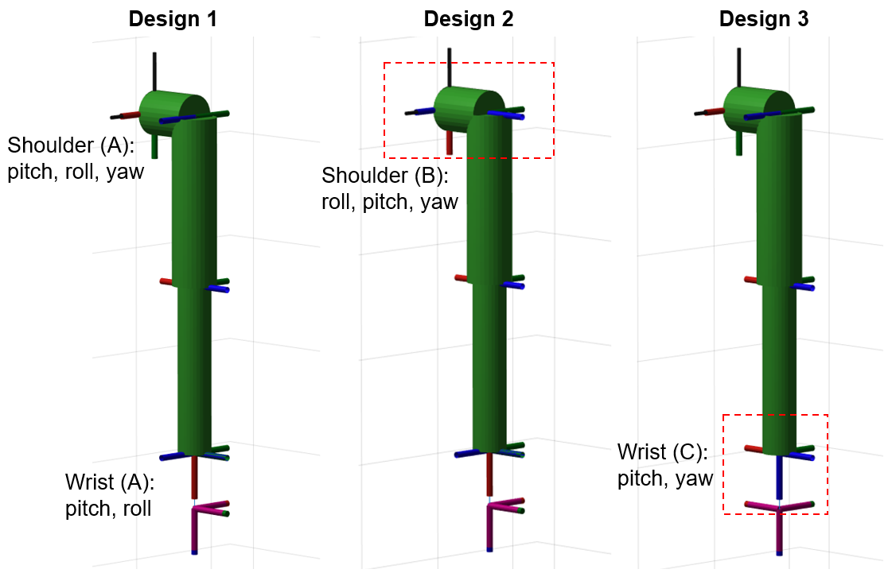

Only the degrees of freedom are modified here for the comparison; the reader can equally compare other dimensions, masses or payloads.

##### (2) Static analysis

We now have a simple model with defined degrees of freedom, dimensions and mass. To meet the required payload and dynamic performance, it has to be analysed.

The static analysis comes first: with the required payload, how much torque does every joint need?

At rest, every joint carries the gravity torque of the arm itself and of the payload. It clearly depends on the posture: the larger the lever arm, the larger the torque.

The first method is random sampling, which gives the joint torque demand for arbitrary postures.

In the configuration file
```
config/config_modeling.yaml
```
the number of samples is defined:
```
num_sampling: 50000
```
Then run
```
script_static_joint_load
```
which draws random postures within the joint limits and computes the static joint torques.

The result for scheme 1 is shown below.
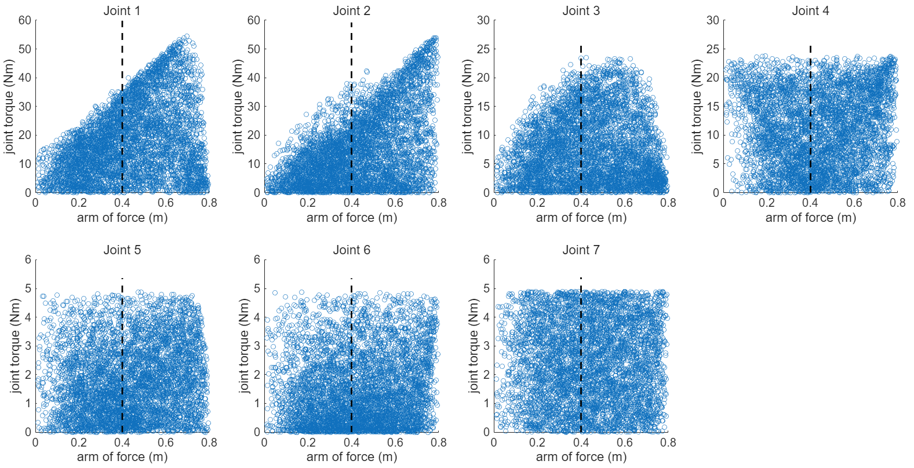

The x axis is the horizontal distance of the end point from the base (the code uses the horizontal projection of the end frame origin, norm(T(1:2,4)) — the distance of the end point from the base axis in the horizontal plane, not the three-dimensional distance from base to end). The shoulder pitch and roll joints demand more torque the further the arm is extended. The shoulder yaw joint (the joint rotating about the upper-arm axis, joint 3 in the figure) instead peaks when the elbow is bent, because only then does the payload have a lever arm about that axis; as the arm extends, the elbow straightens, the lever arm of the shoulder yaw joint shrinks and so does its torque. The elbow and wrist joints, finally, can reach their maximum lever arm in almost any posture, so their demand depends little on the extension of the arm.

Payload specifications normally distinguish a full-arm-length load from a half-arm-length load. Like a person, one does not always handle a heavy object with the arm fully extended; one instinctively bends the elbow to reduce the lever arm.

When designing an arm, one should therefore state whether the payload refers to the full arm length or to the half-arm length. The toolkit provides the corresponding tool: given a lever-arm threshold, it computes the joint torque demand below that threshold. Here the intended arm length is 0.6 m plus a 0.1 m end effector, so 0.7 m; assuming a half-arm-length load at 0.4 m (the black dashed line in the figure), the torque demand of the 5 kg payload is

| Scheme | Load case | Joint 1 | Joint 2 | Joint 3 | Joint 4 | Joint 5 | Joint 6 | Joint 7 |
|------|------|------|------|------|------|------|------|------|
| Scheme 1 | half arm  | 36.66 | 38.14 | 23.44 | 23.86 | 4.89 | 4.88 | 4.90 |
| Scheme 1 | full arm  | 54.95 | 54.85 | 23.79 | 23.95 | 4.89 | 4.90 | 4.90 |
| Scheme 2 | half arm  | 39.59 | 36.55 | 23.15 | 23.83 | 4.90 | 4.89 | 4.90 |
| Scheme 2 | full arm  | 57.14 | 55.02 | 23.79 | 23.90 | 4.90 | 4.90 | 4.90 |
| Scheme 3 | half arm  | 36.46 | 38.48 | 23.62 | 23.95 | 3.44 | 4.90 | 0 |
| Scheme 3 | full arm  | 54.97 | 54.99 | 23.92 | 23.95 | 3.44 | 4.90 | 0 |

> About this table: the "half arm" row is the maximum over random samples whose lever arm is below the 0.4 m threshold (the black dashed line in the figure); the "full arm" row is the **maximum over the whole reachable set** (the "max joint torques" printed by `fun_plot_static_arm_of_force_joint_effort`), not the result of a 0.7 m threshold — with a 0.7 m threshold, joint 1 and joint 2 of scheme 1 would be about 54.6 and 49.6 instead of the 54.95 and 54.85 listed here. The values come from random sampling (`num_sampling: 50000`) with a fixed seed `rng(1)`; the scripts do not fix the seed themselves, so a reader's own run will differ by a few tenths of a Nm. The maximum static torques obtained by the exhaustive posture search in the next subsection are not affected by sampling and are exactly reproducible.

For the shoulder and elbow joints the demand is very similar in the three schemes; given the sampling error it can be regarded as identical. The wrist demand is similar in schemes 1 and 2 but clearly different in scheme 3: the last joint is coaxial with the payload, so there is no eccentricity and no gravity lever arm, and with part of the wrist lever arm gone the torque of joint 5 drops as well.

The static torque demand at half arm length is what defines the rated torque of the joint modules: at half arm length the module can carry the payload indefinitely, which is what continuous handling requires, while other, dynamic operations are of limited duration and may briefly exceed the rated torque. This gives one of the key parameters of the joint module.

The maximum gravity lever arm can also be obtained directly, without random search: for the shoulder joint, for example, the arm is horizontal when the lever arm is maximal. The toolkit therefore offers a second method that enumerates, for every joint, the angles that are multiples of 90 degrees plus the joint limits. This yields the posture with the largest lever arm and the corresponding torque for every joint. Run

```
script_static_max_joint_load
```

to obtain the maximum static torque demand of every joint in the three schemes:

| Scheme | Joint 1 | Joint 2 | Joint 3 | Joint 4 | Joint 5 | Joint 6 | Joint 7 |
|------|------|------|------|------|------|------|------|
| Scheme 1 | 55.14 | 55.14 | 23.96 | 23.96 | 4.9 | 4.9 | 4.9 |
| Scheme 2 | 55.14 | 55.14 | 23.96 | 23.96 | 4.9 | 4.9 | 4.9 |
| Scheme 3 | 55.14 | 55.14 | 23.96 | 23.96 | 3.46 | 4.9 | 0 |

These are the theoretical full-arm-length requirements, and they agree with the sampled analysis above within the sampling error.


##### (3) Dynamics analysis

So far the analysis has been static; the dynamics comes next.

The equation of motion of an arm is
$$
\tau = M(q)\ddot{q} + C(q, \dot{q}) + G(q) + F(\dot{q}) + \tau_{ext}
$$

The static analysis only accounted for gravity and external forces. The full demand is considered here, which gives the torque required during motion.

The mass properties and the payload are already defined by the model, so two more things are needed to solve for the joint torques: the motion (joint angles, velocities, accelerations) and the friction/damping.

The motion is defined in the dynamics configuration file
```
config/config_dynamics.yaml
```
which also defines the time step, i.e. the sampling frequency of the simulated motion.

Two ways of defining a motion are provided (the `trajectory_type` parameter):
1. give the motion directly as a time series, through `trajectory_data_file`;
2. give the start and end states and generate the motion by interpolation.

The start and end states can be given in joint space or in Cartesian space (`planning_space`).

For example, in joint space with zero start and end velocities, moving from the zero (home) configuration to a given posture. The values below are the motion used in this case study and are the default setting of `config_dynamics.yaml` (scheme A):
```
start_configuration: [0,0,0,0,0,0,0]
start_velocity: [0,0,0,0,0,0,0]
end_configuration: [0.7854, -0.5236, 0.6981, -1.0472, 0.7854, 0.5236, 0.7854]  # unit: rad
end_velocity: [0,0,0,0,0,0,0]
```
that is, the functional joint angles [45, -30, 40, -60, 45, 30, 45] deg; see the section "Dynamics simulation: quantitative comparison of the three schemes" below.

In Cartesian space, the start and end poses and velocities are given and the joint angles are first obtained by inverse kinematics. The interpolation can then be done in Cartesian space or in joint space (`interpolation_space`), with a cubic or a quintic polynomial (`interpolation_method`); with a quintic polynomial the accelerations are zero by default since only positions and velocities are given.

With Cartesian interpolation the end effector moves along a straight line and inverse kinematics must be solved for every pose, which frequently has no solution.

One key parameter is still missing: the time from the start to the end state. Given the time, the trajectory follows. The shorter the time, the larger the velocities and accelerations. Since the desired dynamic performance — a maximum velocity or acceleration — was defined at the beginning, the minimum duration can be computed from either of them. Once the interpolation method is fixed, velocity and acceleration are related and cannot both be prescribed; giving one of them determines the duration. There is also a mode that computes the minimum duration from the maximum torque and velocity of the joint modules.

The definition is selected through `constraint_mode`; only the parameters of the selected mode take effect.

Once the start and end states and the interpolation method are fixed, the actual duration can be determined by a maximum velocity or by a maximum acceleration, but the relation between the two is not intuitive: a larger acceleration reaches a higher velocity within a shorter distance, while two states far apart already reach a high velocity with a small acceleration, and two states close together need an enormous acceleration to reach a high velocity.

The dynamics equation also contains a friction term, which the current model cannot represent. Friction and damping come mainly from the transmission chain, and their model is usually complicated, so they are represented simply by a joint transmission efficiency between 0 and 1, the fraction of energy lost. When in doubt a low value can be used to keep a margin in the simulation.

The transmission of a joint module is usually a motor with a gearbox: the motor turns fast with a low torque and the gearbox converts this into a slow, high-torque rotation. Before the gearbox the speed, and hence the angular acceleration, is high, so the motor rotor, the coupling and the high-speed side of the gearbox consume part of the torque even though their inertia is small. With the transmission efficiency, the joint-side transmission model is
$$
\tau = (J_m + J_g) \rho^2 \ddot{q} + \frac{1}{\eta} \tau_{ext}
$$
where the left-hand side is the torque required at the joint, the first term on the right is consumed at the high-speed side and the second is the external load. Here eta is the transmission efficiency, rho the gear ratio, and J_m and J_g the inertia of the motor rotor and of the high-speed side of the gearbox.

The expression above is the **joint-side** form. The function `fun_trajectory_inverse_dynamics` returns the **motor-side** torque (before the gearbox), namely
$$
\tau_m = J_m \rho \ddot{q} + \frac{\tau_{out}}{\rho \eta}, \qquad \omega_m = \rho \dot{q}
$$
The two differ by one gear ratio (tau_joint = rho * tau_m), which is why the torque figures show both tau_motor and tau_out. Note also that the code does not separate J_g; the high-speed side inertia must be folded into `motor_inertia`.

These parameters are defined by the transmission loss entries:
```
consider_transmission_loss: false
motor_inertia: [68e-6,68e-6,34e-6,46e-6,46e-6,10e-6,10e-6]   # Unit: kg*m^2
gear_ratio: [22,22,28,16.5,16.5,13.5,13.5]
transmission_efficiency: [0.85,0.85,0.9,0.85,0.85,0.85,0.85]  # between 0~1
```

##### (4) Dynamics simulation: quantitative comparison of the three schemes

The previous section only defined how a dynamics simulation is set up. Here the three schemes each execute the same commanded motion, and their joint torque demands are compared.

The procedure is the same as before: **switch the scheme through the configuration files and run the same script**

```
>> script_dynamics
```

The configuration blocks to activate for each scheme are:

| Scheme | config_modeling.yaml | config_manual_robot.yaml | config_dynamics.yaml |
|------|------|------|------|
| Scheme 1 | joint limits (A), end_load_pos (A, B) | Case A | end_configuration (A) |
| Scheme 2 | joint limits (B), end_load_pos (A, B) | Scheme B | end_configuration (B) |
| Scheme 3 | joint limits (C), end_load_pos (C) | Scheme C | end_configuration (A) |

Scheme 3 requires switching `end_load_pos` **as well**: its payload is offset along the forearm axis, unlike the lateral offset of schemes 1 and 2. Switching only Link7 and forgetting `end_load_pos` gives a wrong model — the check is simple: at the home posture the end origin must be (0, 0.100, -0.700) m, and with the wrong switch it becomes (0, 0, -0.600) m.

The constraint mode also matters: this section uses `constraint_mode = 1` (fixed duration) with `trajectory_duration = 2`; the stochastic dynamics of section (5) uses `constraint_mode = 2` (5 m/s maximum end-effector velocity). The corresponding commented blocks in `config_dynamics.yaml` must be activated when switching.

The motion below is already the default in `config_dynamics.yaml` (`trajectory_type = 2`, `planning_space = joint`, angles converted to rad), and all numbers in the tables are printed by `script_dynamics` itself.

**Definition of the motion**

So that the comparison reflects only the axis layout, the three schemes execute the **same commanded motion**, defined in joint space:

1. **Start**: the home configuration, i.e. all joint angles zero (arm hanging down, fully extended).
2. **End**: given by 7 **functional joint angles**, i.e. by the function of each joint rather than by its index. Unit: deg.

| Function | End angle |
|------|------|
| shoulder pitch | 45 |
| shoulder roll | -30 |
| shoulder yaw | 40 |
| elbow pitch | -60 |
| elbow roll | 45 |
| wrist pitch | 30 |
| last joint | 45 |

3. Since the joint numbering differs between schemes, the functional angles are mapped onto the joint indices of each scheme:

| Function | Scheme 1 joint | Scheme 2 joint | Scheme 3 joint |
|------|------|------|------|
| shoulder pitch | 1 | 2 | 1 |
| shoulder roll | 2 | 1 | 2 |
| shoulder yaw | 3 | 3 | 3 |
| elbow pitch | 4 | 4 | 4 |
| elbow roll | 5 | 5 | 5 |
| wrist pitch | 6 | 6 | 6 |
| last joint | 7 (wrist roll) | 7 (wrist roll) | 7 (about the forearm axis) |

The end joint angles are therefore [45, -30, 40, -60, 45, 30, 45] deg for scheme 1 and [-30, 45, 40, -60, 45, 30, 45] deg for scheme 2 (the first two joints swapped); scheme 3 is identical to scheme 1. All angles are inside the joint limits of the respective scheme.

Note that joint 7 of scheme 3 is functionally different from schemes 1 and 2: it has no wrist roll freedom but only rotates about the forearm axis. That is precisely the difference to be compared.

4. **Interpolation**: cubic interpolation in joint space with zero start and end velocities; `constraint_mode = 1` rescales the motion to a common duration of **2 s**. The payload is already in the model (see `config_modeling.yaml`), so no additional external wrench is applied.

Because the commanded joint angles are identical, the amplitudes of q(t), qd(t) and qdd(t) are identical too (the identical maximum joint velocities in the table below verify this). **The differences in torque therefore come only from the axis layout and the mass distribution, not from the motion itself.**

**Result 1: maximum joint torque**

| Functional joint | Scheme 1 | Scheme 2 | Scheme 3 |
|------|------|------|------|
| shoulder pitch | 9.67 | 13.34 | 11.99 |
| shoulder roll | 18.82 | 14.41 | 20.54 |
| shoulder yaw | 11.77 | 12.87 | 12.10 |
| elbow pitch | 8.29 | 9.96 | 7.16 |
| elbow roll | 1.99 | 2.36 | 0.57 |
| wrist pitch | 1.10 | 1.58 | 1.55 |
| last joint | 2.08 | 1.99 | 0.02 |
| **global maximum** | **18.82** | **14.41** | **20.54** |

Unit: Nm.

**Result 2: decomposition into gravity and inertial terms**

Setting the velocities and accelerations of the same trajectory to zero isolates the gravity term; the difference between the two is the inertial term (inertia, Coriolis and centrifugal contributions).

| Maximum absolute value per DOF | Scheme 1 | Scheme 2 | Scheme 3 |
|------|------|------|------|
| gravity term | 20.66 | 17.28 | 22.50 |
| inertial term | 2.46 | 2.98 | 2.74 |
| combined (actual demand) | 18.82 | 14.41 | 20.54 |

Unit: Nm. The inertial term is only 12%~17% of the gravity term, i.e. at this speed (joint excursions of 45°~60° within 2 s) **the joint torque is essentially determined by gravity**. The maxima also occur at different instants: in the middle of the motion, where the velocity is highest, the inertial term partly cancels gravity, so the maximum of the gravity term is slightly larger than the maximum of the combined torque.

**Result 3: velocity, power and utilisation**

- The maximum joint velocities are identical in the three schemes (0.59 / 0.39 / 0.52 / 0.79 / 0.59 / 0.39 / 0.59 rad/s), which verifies that the commanded motion is the same.
- The maximum joint power is small, 7.02 W globally.
- Relative to the peak torque of the joint modules (135 / 135 / 67.5 / 82.8 / 82.8 / 41.4 / 41.4 Nm), the highest torque utilisation of this motion is 19%.
- Compared with the maximum static torque (55.14 Nm), this motion needs less than 40% of it. In other words, for this motion **the actuator selection is governed by the static payload requirement, not by the motion itself**.

**Result 4: end-effector motion**

With the same joint command, the resulting end-effector motion differs between schemes:

| | Scheme 1 | Scheme 2 | Scheme 3 |
|------|------|------|------|
| maximum end-effector velocity (m/s) | 0.389 | 0.440 | 0.414 |
| maximum end-effector acceleration (m/s^2) | 0.866 | 1.069 | 0.830 |
| end-effector displacement (m) | 0.446 | 0.502 | 0.492 |
| end point (m) | (-0.017, -0.261, -0.438) | (-0.114, -0.312, -0.437) | (-0.070, -0.315, -0.446) |

All three start at (0, 0.100, -0.700) m. For the same joint rotations, scheme 2 moves the end effector about 12% further.

**Figures**

All figures below are produced by `script_dynamics` (only scheme 1 is shown for the joint torques; the other two are structurally identical).

Joint states of scheme 1 (position, velocity, acceleration):

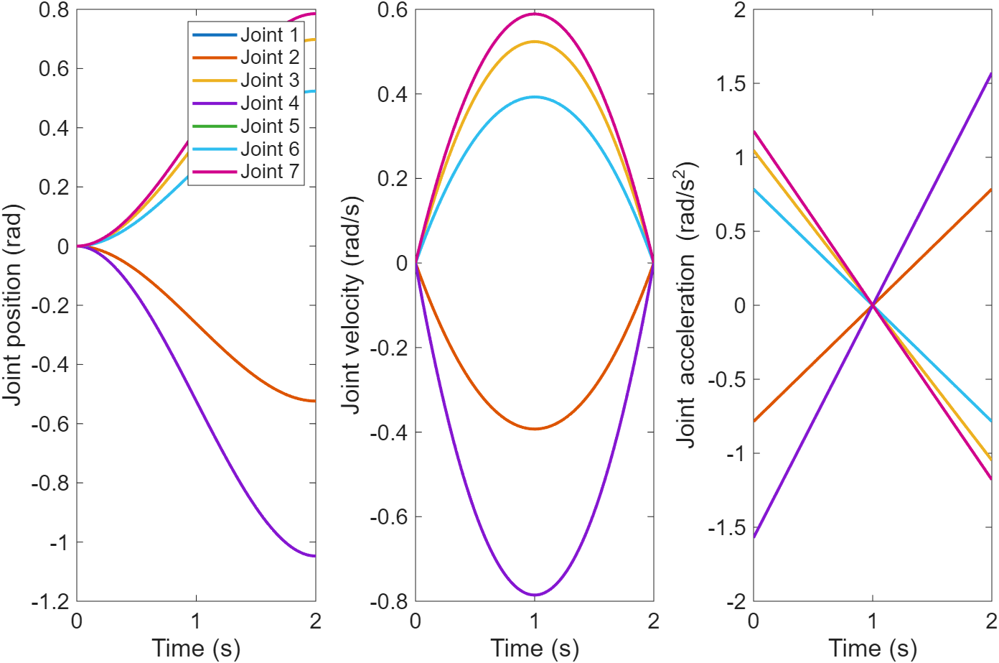

Joint torques of scheme 1 (the second row is the output torque tau_out, which corresponds to the table above):

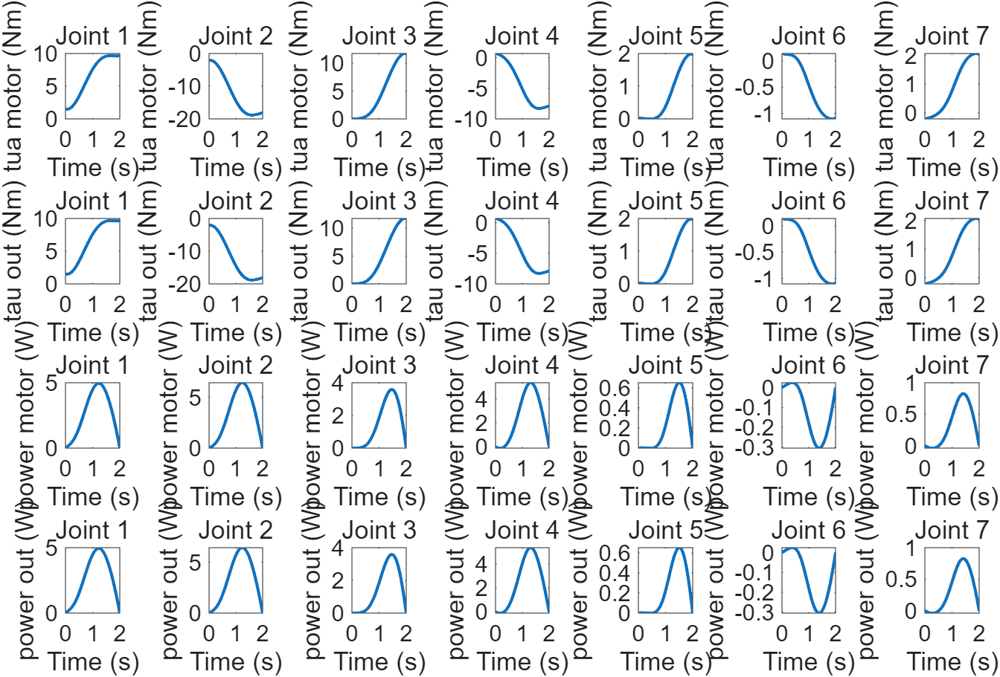

Joint torques of schemes 2 and 3:

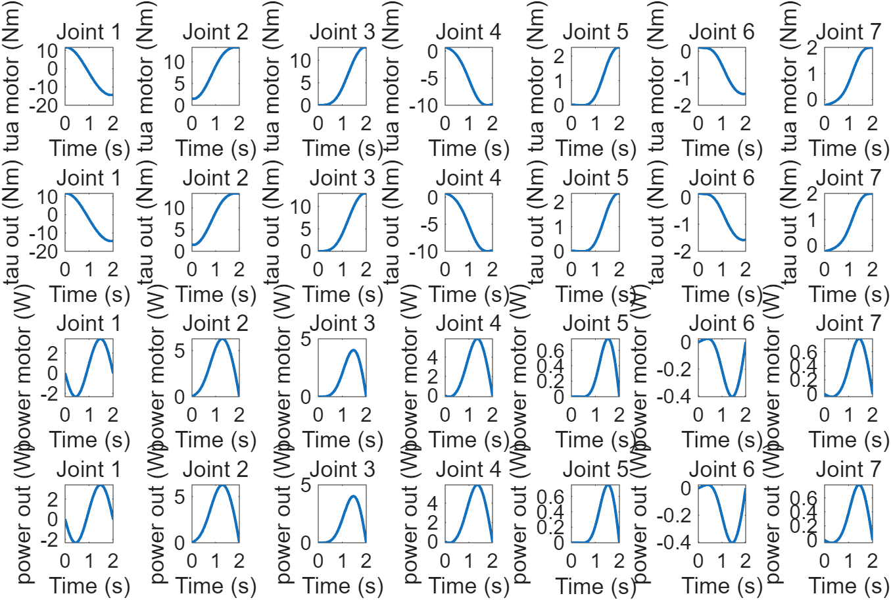
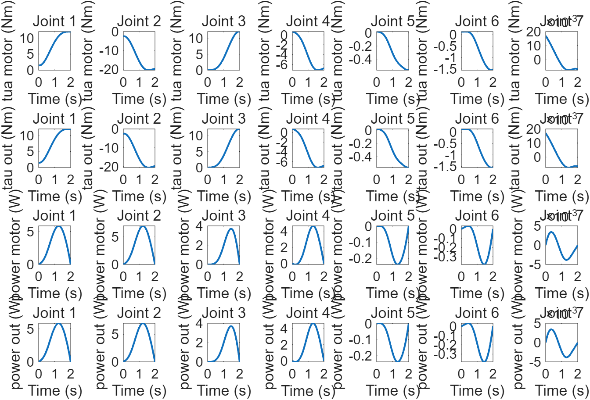

End-effector motion of scheme 1:

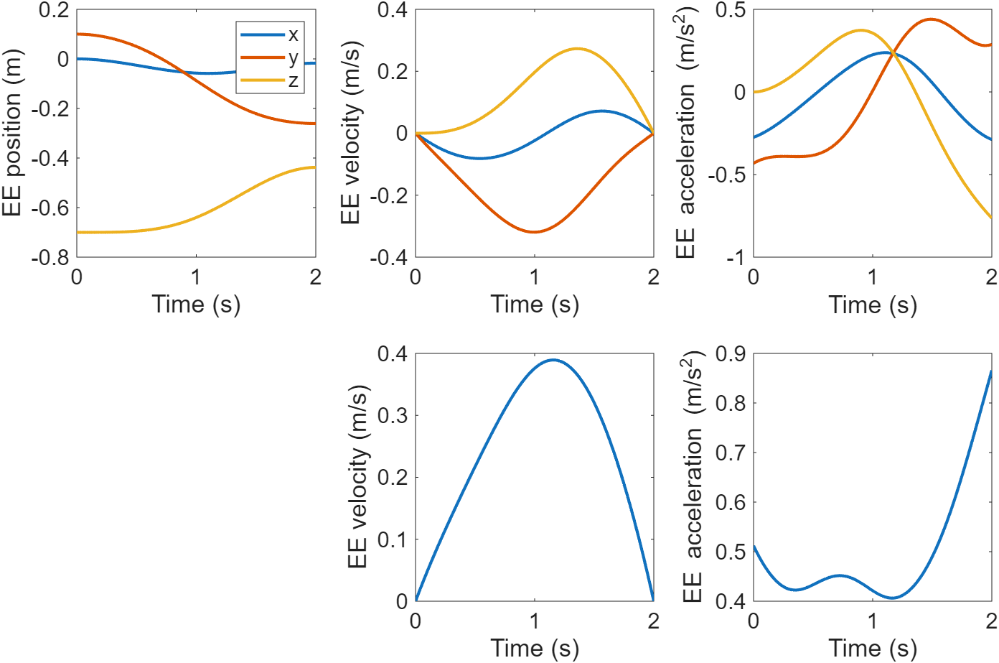

Since the joint commands are identical, the amplitudes in the joint state figures are the same as well, except that the first two joints of scheme 2 are swapped; the torque figures are what shows the difference in layout.

**Conclusions**

1. **The order of the shoulder joints (scheme 1 ↔ scheme 2) only redistributes the demand between the two shoulder joints; it does not change the total.** Shoulder pitch +38% (9.67→13.34), shoulder roll -23% (18.82→14.41), with the sum essentially unchanged (28.5 and 27.8 Nm); the maximum static torque of the selected joint modules is identical in both (55.14 Nm). The shoulder order can therefore be decided by cabling, structure and other considerations.
2. **Whether the wrist is coaxial with the payload (scheme 1 ↔ scheme 3) is decisive.** The torque of the last joint drops from 2.08 Nm to 0.02 Nm (essentially zero, only the inertia of the last link remains) and the elbow roll by 71% (1.99→0.57); the price is +9% on the shoulder roll (18.82→20.54), because the payload offset changes from lateral to axial. This agrees with the static analysis: the wrist layout changes the specification of two wrist joints, and since the wrist sits at the end of the arm, the mass saving is the largest.
3. At this speed the dynamic demand is far below the static demand (less than 40%), so **the actuator selection is governed by the static payload**. This is the case for a motion completed in 2 s; section (5) will show that with the 5 m/s end-effector target proposed at the beginning the conclusion is exactly the opposite — the demand is dominated by inertia and far exceeds both the static demand and the capability of the modules.

##### (5) Stochastic dynamics analysis: quantitative comparison of the three schemes

Both previous sections used **one specified motion**. An arm in real use performs a wide variety of motions, and one posture or one trajectory is not enough to judge the joint requirements. This section therefore **generates a large number of random motions** within the joint limits and collects the demand of each of them, which gives a joint specification that does not depend on a particular motion.

**Method**

1. Draw two joint configurations q1 and q2 uniformly at random within the joint limits, requiring an end-effector distance of at least `min_ee_distance` (0.1 m in the current configuration), otherwise resample;
2. Connect q1 and q2 by joint-space interpolation and rescale each trajectory to the same constraint through `constraint_mode`: this section uses **`constraint_mode = 2` (given maximum end-effector velocity)**, i.e. every trajectory is scaled so that its maximum end-effector velocity equals `max_ee_velocity`, here the **5 m/s proposed at the beginning**. Note that section (4) uses `constraint_mode = 1` (fixed 2 s duration); the corresponding commented blocks in `config_dynamics.yaml` must be activated for each section;
3. Run forward kinematics (end-effector position, velocity, acceleration) and inverse dynamics (joint torque, power) for every trajectory and record its **maximum**;
4. Plot the results against the **travel distance** of the trajectory (the end-effector distance between q1 and q2), with the mean and standard deviation superimposed;
5. For a given travel-distance threshold (0.2 m below), take the **97.72th percentile** of that subset (two standard deviations of a normal distribution) as the recommended specification of the joint.

The number of samples is set by `num_samples` in `config_stochastic_dynamics.yaml`. **To keep the whole run fast, this section reduces it to 100 samples**, disables parallel computation and fixes the random seed `rng(1)` for reproducibility; for production use, increase `num_samples` and enable `use_parallel`. Run:

```
>> script_stochastic_dynamics_analysis
>> script_stochastic_dynamics_visualization
```

The first script simulates and writes the result to `data/stochastic_dynamics/stoch_dyn.mat`; the second reads it, computes the statistics and plots them. **Note** that random sampling makes the results fluctuate: with 100 samples, differences below 10% should not be over-interpreted, and the 97.72th percentile is estimated from the largest few samples, i.e. close to the sample maximum.

As "Result 3" below shows, the random motions last between 0.09 and 0.96 s (median about 0.37 s), far shorter than the 2 s of section (4) — a direct consequence of the velocity constraint.

**Result 1: joint torque demand (97.72th percentile, travel distance ≥ 0.2 m)**

| Joint | Scheme 1 | Scheme 2 | Scheme 3 |
|------|------|------|------|
| 1 | 404.61 | 426.72 | 403.73 |
| 2 | 628.01 | 587.70 | 702.74 |
| 3 | 315.25 | 205.62 | 294.14 |
| 4 | 263.38 | 329.96 | 308.41 |
| 5 | 56.89 | 59.18 | 46.27 |
| 6 | 65.70 | 56.91 | 78.43 |
| 7 | 58.27 | 70.55 | **6.25** |

Unit: Nm. The joint indices here are the **physical** joint indices (not the functional order used before); the first two joints of scheme 2 are still the shoulder roll and shoulder pitch swapped.

**Result 2: joint velocity demand (97.72th percentile, in rpm)**

| Joint | Scheme 1 | Scheme 2 | Scheme 3 |
|------|------|------|------|
| 1 | 200.95 | 162.62 | 203.38 |
| 2 | 113.29 | 141.92 | 121.80 |
| 3 | 210.75 | 192.72 | 213.22 |
| 4 | 122.51 | 126.85 | 103.42 |
| 5 | 219.89 | 344.22 | 264.70 |
| 6 | 88.73 | 91.73 | 116.40 |
| 7 | 135.97 | 181.39 | **372.52** |

Against the peak velocity of the joint modules (90 / 90 / 90 / 180 / 180 / 360 / 360 rpm): joints 1, 2, 3 and 5 exceed their capability (about 2.2 times for joints 1 and 3, 1.2~1.9 times for joint 5), and joint 7 of scheme 3 just exceeds it as well (372.5 against 360 rpm).

**Result 3: distribution of the motions**

| | Scheme 1 | Scheme 2 | Scheme 3 |
|------|------|------|------|
| samples | 100 | 100 | 100 |
| duration min / median / max (s) | 0.09 / 0.365 / 0.96 | 0.09 / 0.38 / 0.92 | 0.09 / 0.36 / 0.93 |
| median travel distance (m) | 0.605 | 0.651 | 0.632 |
| samples with distance ≥ 0.2 m | 97 | 99 | 98 |
| mean maximum end-effector velocity (m/s) | 5.00 | 4.99 | 5.00 |
| mean maximum end-effector acceleration (m/s^2) | 89.15 | 87.77 | 87.41 |

**Figures**

Joint torque demand of scheme 1 against the travel distance (scatter with mean error bars, dashed line = peak torque of the joint modules):

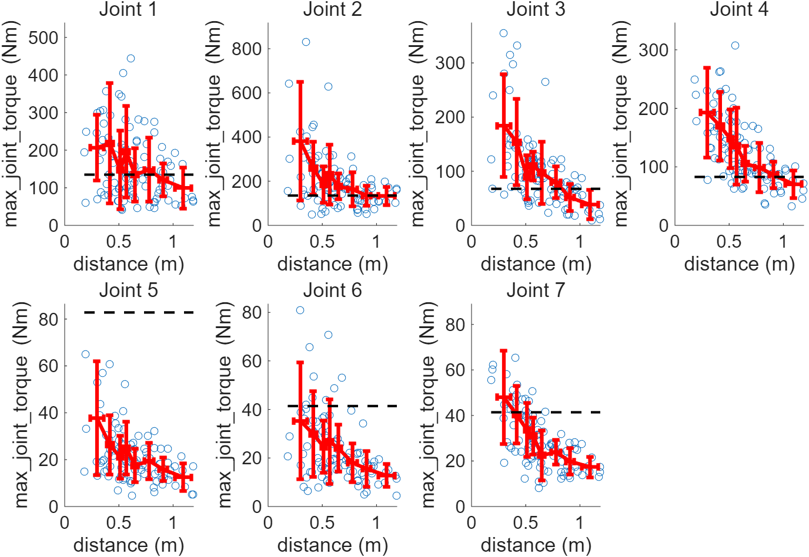

Joint velocity demand of scheme 1 against the travel distance:

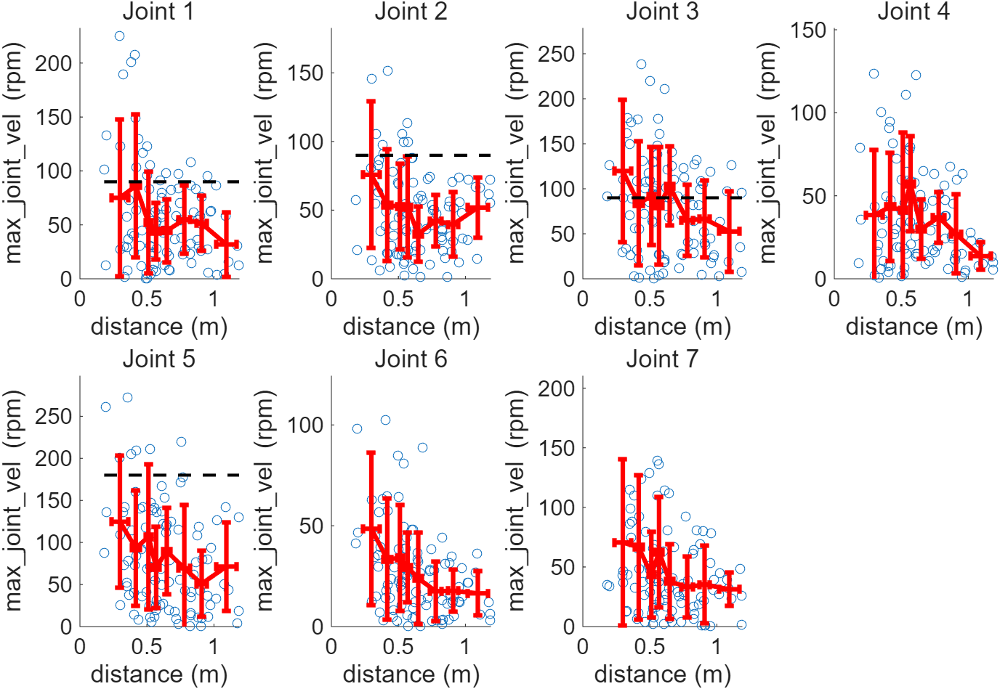

Kinematic distributions of scheme 1 (duration, distance, maximum end-effector velocity and acceleration):

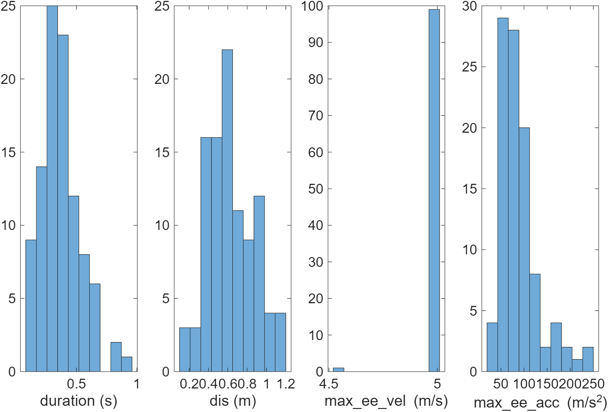

Joint torque demand of schemes 2 and 3:

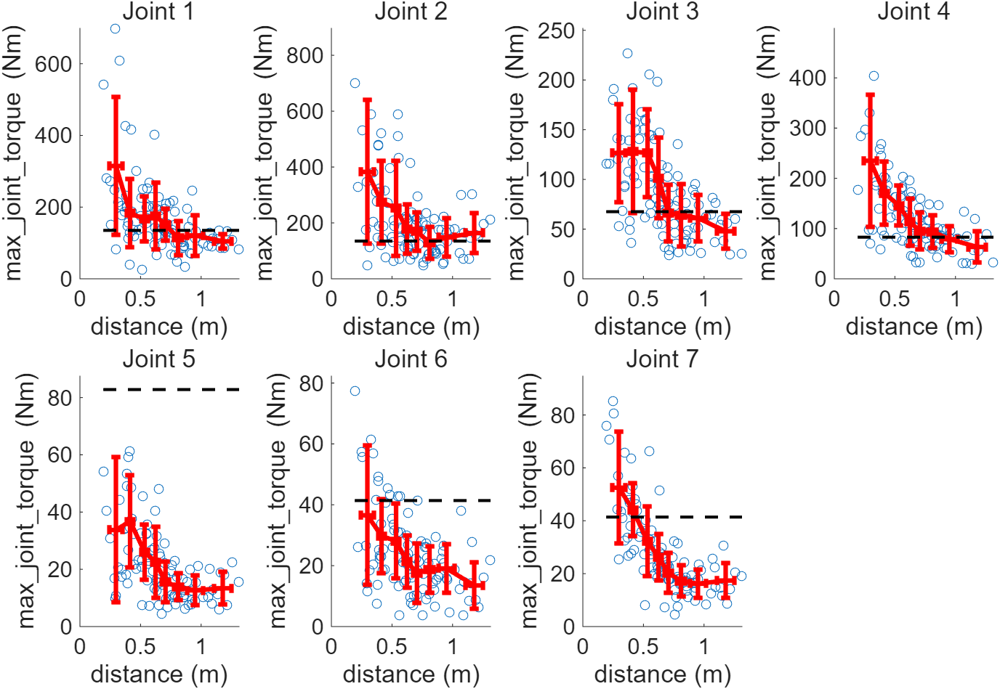
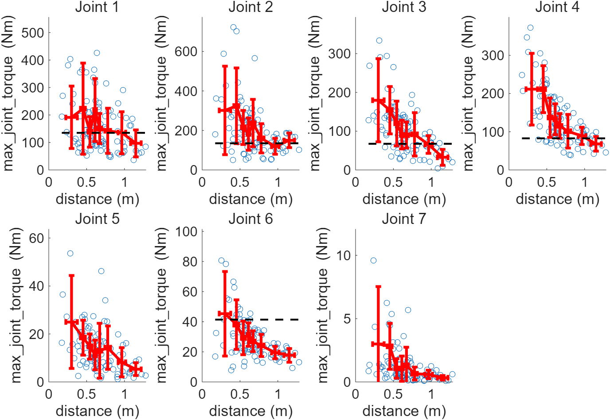

**Conclusions**

1. **At this velocity target the demand is entirely dominated by inertia**: the two shoulder joints need 404~703 Nm and the elbow 263~330 Nm, while the worst static case is only 55.14 Nm and the 2 s motion of section (4) only 18.8 Nm — a factor of 7~13. The reason is direct: to reach 5 m/s within a travel of about 0.6 m, the end-effector acceleration must approach 90 m/s^2, the joint accelerations follow into the hundreds of rad/s^2, and the inertial term far exceeds the gravity term.
2. **The demand does not match the selected joint modules**: in torque, joints 1~4 all exceed their peak capability (joint 2 needs 588~703 Nm, i.e. 4.4~5.2 times the 135 Nm capability; joint 1 needs 404~427 Nm; joints 3 and 4 need 206~315 and 263~330 Nm against capabilities of 67.5 and 82.8 Nm). The wrist picture is mixed and worth stating precisely: joint 5 stays inside its 82.8 Nm capability (46~59 Nm), joint 6 exceeds its 41.4 Nm in all three schemes (57~78 Nm), and joint 7 exceeds it in schemes 1 and 2 (58.3 and 70.6 Nm) but needs only 6.25 Nm in scheme 3. In velocity, joints 1 and 3 need about 200 rpm (capability 90 rpm) and joint 5 needs 220~344 rpm (capability 180 rpm), while joint 7 of scheme 3 just exceeds its limit (372.5 against 360 rpm). With a 5 m/s target, this set of joint modules would have to be reselected almost entirely.
3. **The two targets proposed at the beginning are mutually inconsistent**: accelerating the end effector to 5 m/s at 10 m/s^2 requires at least $v^2/(2a) = 1.25$ m of travel, while this arm extends to only 0.7 m. The simulation gives end-effector accelerations of 87~89 m/s^2, about nine times the stated limit. "Maximum velocity 5 m/s" and "maximum acceleration 10 m/s^2" therefore cannot both hold — exactly the situation described in section (3): velocity and acceleration cannot both be satisfied, and one of them must define the motion.
4. **The advantage of the coaxial wrist weakens at high speed but remains**: the demand of joint 7 drops from 58.27 / 70.55 Nm to **6.25 Nm** (about one tenth), and joint 5 from 56.89 / 59.18 to 46.27 Nm (-19%). Note, however, that at low speed joint 7 of scheme 3 is essentially torque-free (its gravity term is zero) while at high speed it still carries about 6 Nm through inertial coupling — **"a coaxial load carries no torque" holds only in the gravity-dominated, low-speed regime**.
5. **At this magnitude the differences between the schemes no longer decide the selection**: the shoulder demand is 400~700 Nm in all three, and the 10~20% differences between them are of the same order as the sampling noise. What decides whether a scheme is feasible is the velocity target itself.
6. **To find out how fast the existing modules can drive the arm, use `constraint_mode = 4`** (minimum motion time under the joint torque and velocity limits) instead of assuming a velocity and checking afterwards whether it is feasible.

##### (6) Workspace analysis: quantitative comparison of the three schemes

The previous sections answered the mechanical question of whether the joints can carry the demand. The workspace analysis answers a different question: **where can the end effector go, and in how many orientations can it get there**. Together the two determine the design of the arm, and they often conflict — as already seen, the axis layout affects both.

**Method**

1. Generate a grid of positions within a given range according to `position_resolution`, keeping only the points whose distance from the base is within `arm_length`;
2. For every position, take `orientation_discretization_num` roughly uniformly distributed directions as **approach directions** (the direction of the z axis of the end frame);
3. For every "position + direction" pair, solve a **constrained inverse kinematics** problem: the position constraint (the end origin reaches the target point) and the direction constraint (the end z axis points along the given direction) must both be satisfied for the pair to count as reachable. This is a five-dimensional constraint on a 7-DOF arm, so some pairs have no solution;
4. The reachability of a position is the fraction of feasible directions there, called its **dexterity** (0~1); positions with no feasible direction at all are discarded;
5. Plot the reachable workspace coloured by dexterity and report the number of reachable positions, the reachable volume and the mean dexterity.

The relevant configuration entries are in `config_workspace.yaml`. **This section coarsens the position resolution to 0.15 m and reduces the number of directions to 12**, otherwise the three schemes cannot be computed in a reasonable time (the default configuration uses 0.05 m and 36 directions, 23 times as many samples). Run:

```
>> script_workspace_analysis
>> script_workspace_visualization
```

The first script analyses and writes the result to `data/workspace/workspace_ik.mat`; the second reads it and plots it.

**About self-collision checking**: `consider_self_collision` is set to `false` here because the manual (cylinder) model cannot pass a self-collision check — the collision cylinder of the shoulder link and the one of the upper arm touch at the shoulder joint (Link2 has zero length and no collision geometry, so the two are not treated as neighbouring links), with the result that **every posture is reported as a collision and the number of reachable positions is zero**. Self-collision checking only becomes meaningful with a URDF model.

**Result 1: reachability and dexterity**

| | Scheme 1 | Scheme 2 | Scheme 3 |
|------|------|------|------|
| reachable positions | 246 | 265 | 245 |
| reachable volume (m^3) | 0.830 | 0.894 | 0.827 |
| mean dexterity | 0.570 | 0.594 | **0.348** |
| maximum dexterity | 1.000 | 1.000 | **0.667** |
| fraction of positions with dexterity ≥ 0.5 | 68% | 73% | **21%** |

With a position resolution of 0.15 m and 12 directions, the grid inside the intersection of the sampling box and the arm-length sphere (`arm_length: 0.8`) contains 336 positions; the reachable positions in the table are those among them that the constrained inverse kinematics solved successfully.

**Figures**

Reachable workspace of the three schemes (the point colour is the dexterity; see the separate colour-bar figure produced by the plotting script):

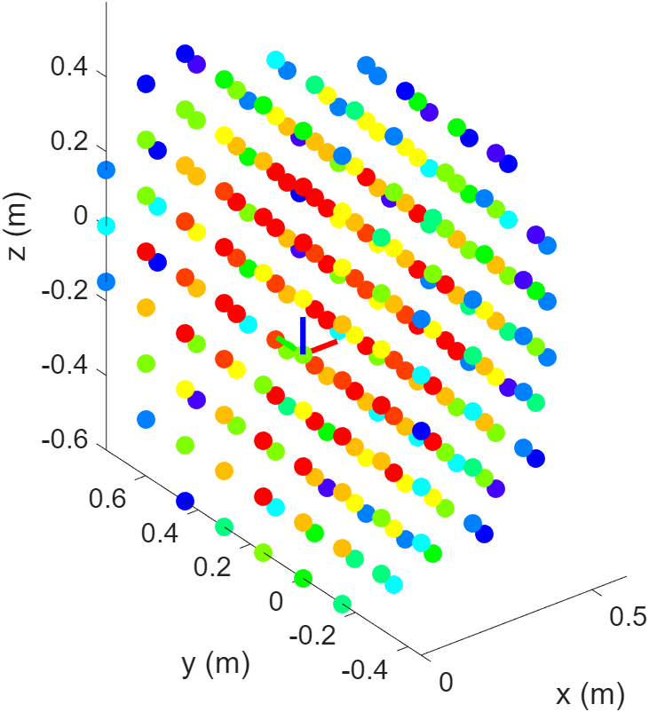
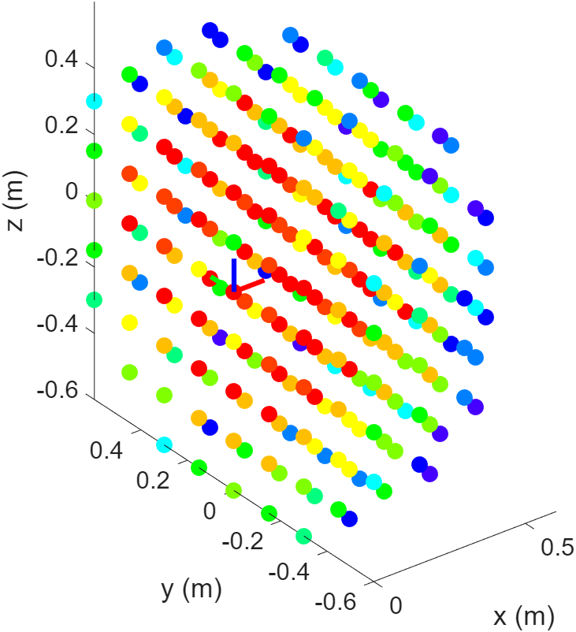
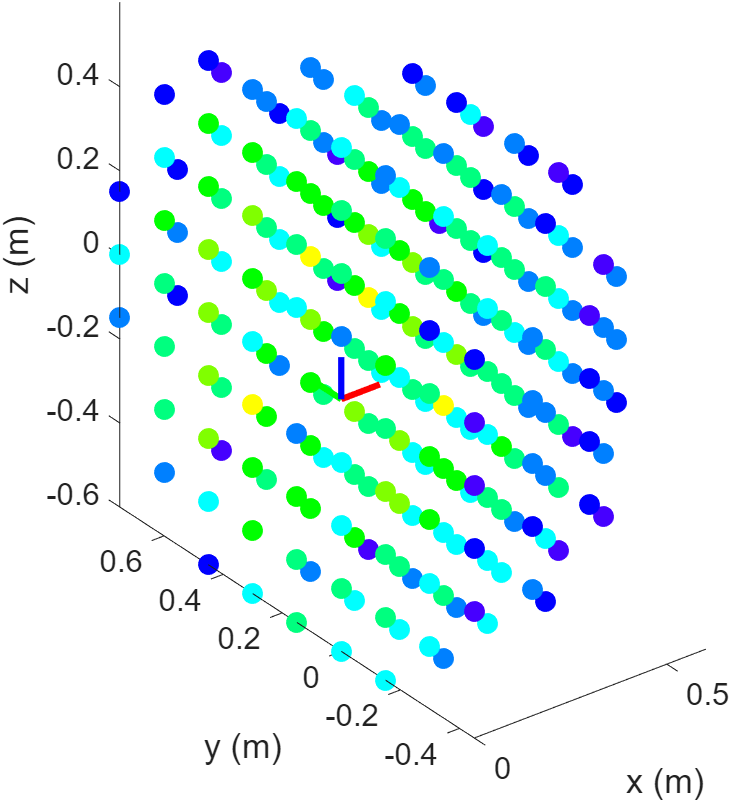

**Conclusions**

1. **The axis layout has almost no effect on where the arm can reach**: 246 / 265 / 245 reachable positions and reachable volumes of 0.83 / 0.89 / 0.83 m^3, scheme 2 being only about 8% larger. This agrees with the earlier conclusion that the shoulder order does not change the selection — swapping the two shoulder joints leaves the workspace essentially unchanged.
2. **The orientation capability differs substantially**: the mean dexterity is 0.570 / 0.594 / **0.348**, the maximum dexterity of scheme 3 is only 0.667 (schemes 1 and 2 reach all 12 directions at some positions), and the fraction of positions with dexterity ≥ 0.5 is 68% / 73% / **21%**. **Scheme 3 reduces the wrist joint torques while clearly sacrificing orientation reachability** — two sides of the same design decision: making the last joint coaxial with the load saves torque but removes the ability to change the tool direction (joint 7 can only rotate about the forearm axis).
3. **The comparison is made with the same convention**: as verified in MATLAB at the home posture, the end frames of the three schemes are identical — the end origin is (0, 0.1, -0.7) and the end z axis is (0, 0, -1) (along the forearm, pointing down) in all three. Although the payload offset differs (lateral in schemes 1 and 2 with a 1.5708 rad pitch, axial in scheme 3), the two parameterizations produce the same end frame, and the 12 approach directions are defined with respect to that same frame. The lower dexterity of scheme 3 is therefore a genuine loss of kinematic freedom — with joint 7 collinear with the tool axis the tool can only roll about its own axis and can no longer be reoriented — and not an artefact of differing frame conventions.
4. **About the resolution**: with a 0.15 m grid and 12 directions the reachable volume is a coarse estimate (each reachable position counted as a full cube) and the dexterity can only take the discrete values 0/12 to 12/12. A finer grid changes these numbers but not the two relations above. They can be recomputed with `position_resolution` and `orientation_discretization_num` in `config_workspace.yaml`, at the cost of time (the default 0.05 m and 36 directions take on the order of ten hours).

##### (7) Summary of the three schemes and conclusions

**Summary**

| Quantity | Scheme 1 | Scheme 2 | Scheme 3 |
|------|------|------|------|
| difference from scheme 1 | baseline | shoulder: roll before pitch | wrist: joint 7 about the forearm axis |
| rated torque at half arm (Nm) | 36.66 / 38.14 / 23.44 / 23.86 / 4.89 / 4.88 / 4.90 | 39.59 / 36.55 / 23.15 / 23.83 / 4.90 / 4.89 / 4.90 | 36.46 / 38.48 / 23.62 / 23.95 / **3.44** / 4.90 / **0** |
| maximum static torque (Nm) | 55.14 / 55.14 / 23.96 / 23.96 / 4.90 / 4.90 / 4.90 | same as scheme 1 | 55.14 / 55.14 / 23.96 / 23.96 / **3.46** / 4.90 / **0** |
| maximum torque of the 2 s motion (Nm) / utilisation | 18.82 / 14% | 14.41 / 11% | 20.54 / 15% |
| 5 m/s scan, J1 / J2 (Nm) | 404.6 / 628.0 | 426.7 / 587.7 | 403.7 / 702.7 |
| 5 m/s scan, J7 (Nm) | 58.27 | 70.55 | **6.25** |
| 5 m/s scan, J1 velocity (rpm) | 200.95 | 162.62 | 203.38 |
| reachable volume (m^3) | 0.830 | 0.894 | 0.827 |
| mean dexterity | 0.570 | 0.594 | **0.348** |

Torques are given for joints J1~J7. For reference, the joint modules selected in this case study have peak torques of 135 / 135 / 67.5 / 82.8 / 82.8 / 41.4 / 41.4 Nm and peak velocities of 90 / 90 / 90 / 180 / 180 / 360 / 360 rpm.

**Conclusions**

1. **What determines the joint specification is the static payload, not a particular motion.** The half-arm rated demand (about 37 / 38 / 23 / 24 Nm) is nearly identical in the three schemes, and the maximum static torque of 55.14 Nm is given exactly by the orthogonal posture search. A typical 2 s motion uses only 11%~15% of the peak capability, while a high-speed motion at the 5 m/s target pushes the demand to 400~700 Nm — **the same joints can differ by more than a factor of ten between operating conditions**, so the operating condition must be fixed before the specification is discussed.
2. **The shoulder joint order (scheme 1 ↔ scheme 2) is not a key design variable.** Statically the maximum torques are identical (55.14 Nm) and the half-arm demand is merely redistributed between the two shoulder joints (J1/J2: 36.66/38.14 → 39.59/36.55, the sum being 74.80 → 76.14 Nm); the workspace differs by 8% (0.830 → 0.894 m^3); only the transient torque distribution of a single motion differs (9.67/18.82 against 13.34/14.41 Nm). This degree of freedom can be given away to cabling, assembly and structure.
3. **Whether the wrist is coaxial with the payload (scheme 1 ↔ scheme 3) is a decisive design variable, and a double-edged one.**
   - Gain: the torque of the last joint goes to zero (maximum static 4.90 → 0 Nm) and the elbow roll drops from 4.90 to 3.44/3.46 Nm (-29%); at the 5 m/s operating point joint 7 still needs only 6.25 Nm (against 58.27 / 70.55 Nm in schemes 1 and 2). The specification of both wrist joints can therefore be lowered substantially, and since the wrist sits at the end of the arm the mass saving is the largest.
   - Price: the orientation capability drops clearly — mean dexterity 0.570 → 0.348, the fraction of positions with dexterity ≥ 0.5 from 68% to 21%, and the maximum dexterity from 1.0 to 0.667; at the same time the shoulder demand rises slightly (J2 from 628.0 to 702.7 Nm at 5 m/s).
   - The choice therefore depends on the task: **approaching a target in many orientations (for example a tool that must keep a given direction) → schemes 1/2; a single required orientation with a light wrist → scheme 3.**
4. **The performance targets must be self-consistent.** 5 m/s and 10 m/s^2 cannot both hold (accelerating to 5 m/s at 10 m/s^2 needs at least 1.25 m of travel, while the arm is only 0.7 m long), and the simulated end-effector acceleration at the 5 m/s target is 87~89 m/s^2, about nine times the stated limit; moreover several joints exceed the capability of the current modules in torque (joints 1~4 in all cases, joint 6 in all three schemes, joint 7 in schemes 1 and 2 but only 6.25 Nm in scheme 3) and some in velocity. **Either lower the velocity target and reselect the modules, or use `constraint_mode = 4` to ask how fast the existing modules can drive the arm.**
5. **One trajectory is not enough to fix a specification.** The single 2 s motion of section (4) gives 18.82 Nm, only 34% of the maximum static value; under random motions (section (5)) the same joints need more than 20 times that. **A specification should combine the worst-case posture (exhaustive search), the statistics of random motions and the workspace — and the random-motion statistics must carry the operating condition (time, velocity, acceleration or module capability).**
6. **The role of the "axis layout" as a design variable in this case study can be summarized as**: the shoulder order has almost no effect; the coaxial wrist trades torque for dexterity; the reachable volume is insensitive to both (0.827~0.894 m^3, within 8%). In other words, **these candidate configurations are essentially equivalent in where they can reach, and the real trade-off is between how much torque is needed and how many orientations are available.**

**Limitations and uncertainties of this section**

1. The absolute torques come from mass and inertia estimated with cylinders plus a point-mass payload; they are suitable for sizing and scheme comparison, not for verification.
2. The static random sampling fluctuates by a few tenths of a Nm (see the note on the static table); the exhaustive posture search is exactly reproducible.
3. The 97.72th percentile of the stochastic dynamics is estimated from 100 samples (close to the sample maximum); differences below 10% should not be over-interpreted.
4. The workspace uses a 0.15 m grid and 12 directions, so the reachable volume is a coarse estimate.
5. The end frames of the three schemes are identical as measured in MATLAB (at the home posture the end origin is (0, 0.1, -0.7) and the end z axis is (0, 0, -1) in all three), so the dexterity comparison is made with the same convention; its uncertainty comes mainly from the grid resolution — see conclusions 3 and 4 of section (6).
6. Self-collision checking cannot be used with the manual (cylinder) model.
7. This case study has no physical experiment and no cross-validation against commercial software.

#### 1.3 Next steps: detailed design and verification

Back to the four-step flow of section 1.1: **requirements → scheme simulation and optimization → detailed design → verification**. This document carries out the second step on a simplified model; the repository also implements the fourth step, which re-runs the same analyses on a real URDF model (Section 1.3). The detailed design in between, and the verification runs themselves, are discussed below but not carried out here.

**(1) Detailed design (outside the scope of this repository)**

The third step is done in CAD/3D design software: structure, transmission, routing, assembly, and the final selection of the joint modules. Its input is exactly the specification produced in section (7) (rated and peak torque, peak velocity, arm length and dimensions) and its output is a **real URDF model**.

This step replaces the approximations deliberately made in the simplified model: the cylinder-based mass distribution, the point-mass payload, the constant gravity direction and the constant transmission efficiency become the real link geometry and inertia, the real gearbox and motor parameters and the real joint limits; it also introduces what this document does not model — structural compliance, backlash, friction and temperature rise.

**(2) Verification (which this repository implements, with the direction of the analysis reversed)**

Put the real model into `urdf/`, set `using_urdf_model: true` and the path of `urdf_model` in `config_modeling.yaml`, and `fun_build_robot` returns the real model (the URDF branch imports it with `importrobot`, and the mass properties come from the model file rather than from the cylinder estimate); all the analyses of sections (2)~(6) can then be reused.

The question has to be turned around, though. Before, the payload (5 kg) was given and the joint torque and velocity were the unknowns; at the verification stage the capability of the selected joint modules is given and the questions are **how much payload, how fast, and how large a workspace they actually deliver**:

* **Payload capability**: treat `end_load` as the unknown (a few candidate values, or a sweep), obtain the torques with the two static analyses of section (2) and compare them with `joint_peak_torque` in `config_dynamics.yaml` to obtain the payload that can be carried at half arm length and at full arm length. The repository has no built-in solver that inverts the problem, but since the static analyses exist it is a matter of changing one parameter and rerunning.
* **Dynamic performance**: use `constraint_mode = 4` — the minimum motion time under the joint torque and velocity limits — to obtain how fast these modules can actually drive the arm. This is closer to the meaning of verification than assuming 5 m/s and checking whether it is feasible (see conclusion 4 of section (5)). Together with the joint velocity demand and the capability envelope, the working point of the modules in the $(\omega, \tau)$ plane can also be checked for margin.
* **Workspace**: the same sampling and constrained inverse kinematics, with the real model and `consider_self_collision` enabled. This check is meaningless for the manual cylinder model (see section (6)) and only makes sense with a real URDF, which yields the workspace that is **genuinely reachable**.

Two practical notes:

1. With a URDF model the joint limits come from the model file (`override_joint_limit: false`) and `fun_build_robot` writes them back into the `config`, so the analysis scripts must be written as `[robot, config] = fun_build_robot(config);` to make sure the subsequent analyses use the same limits;
2. The end effector may already be modelled as a body in the real model; if so, `add_end_load` must be turned off so that it is not counted twice together with `end_load`.

**(3) How the results of this document should be read at the verification stage**

All numbers in this document come from a simplified model and are meant for sizing and scheme comparison; they are **not verification results**. They are reliable for **relative** statements such as which scheme needs less torque and what it costs, while **absolute** statements such as "these modules can certainly carry 5 kg at 5 m/s" remain hypotheses to be verified.

Verification also has to account for what this document does not model: structural compliance and vibration, backlash, friction and temperature rise, controller bandwidth and tracking error, safety margins and failure modes. These usually require higher-fidelity multibody or finite-element simulation, or physical experiments, and statistical results such as the workspace and the stochastic dynamics should be compared with measurements as well.

The whole chain can therefore be summarized as: **use the simplified model to screen and to size, and the real model and measurements to confirm** — two directions of the same toolkit.
