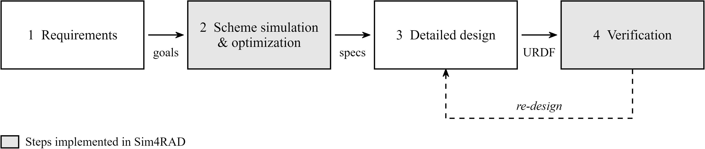

# Sim4RAD: Simulation for Robot Arm Design


A MATLAB toolkit for **design-phase** sizing and actuator selection of serial robotic arms. It builds a rigid-body model from a handful of parameters, so that joint torque, velocity and workspace requirements can be obtained **before any CAD model exists**, and it reuses the same analyses on a URDF model once a detailed design is available. It therefore covers **two of the four steps** of an arm design: scheme simulation and optimization (step 2, on the synthesized model) and verification (step 4, on the URDF model exported from the detailed design).



## Overview

* **Modeling without CAD** — describe the arm by degrees of freedom, joint frames, link radii, an estimated total mass, joint limits, an end load and the gravity direction; the toolkit synthesizes link masses and inertia tensors from cylinders of the given dimensions. A URDF model can be used instead, with the same analyses.
* **Static load analysis** — random sampling of the payload lever arm against joint torque, plus an exhaustive search over postures built from multiples of 90° and the joint limits. This yields a *rated* torque at a chosen payload envelope (e.g. half-arm-length) and a reproducible *peak* torque, and merges the worst cases into a few "typical" postures.
* **Dynamics simulation** — inverse dynamics along a trajectory given either as tabulated data or as start/end states with cubic/quintic interpolation, in joint or Cartesian space, rescaled to satisfy one of four constraints (duration, maximum end-effector velocity, maximum end-effector acceleration, or the actuator torque–speed envelope). An optional transmission model reports motor-side quantities.
* **Stochastic motion requirements** — the same pipeline over many random motions, so that a specification comes from a *class* of motions rather than from one hand-picked trajectory.
* **Workspace and dexterity** — reachability and the number of approach directions available at each reachable point, for comparing kinematic configurations.

Switching a robot, a payload, a layout or a study is done by editing YAML configuration files; no script needs to be modified.

## Requirements

* MATLAB **R2021a** or newer.
* **Robotics System Toolbox** (required).
* **Parallel Computing Toolbox** (optional; used only by the stochastic analyses).

## Quick start

```bash
git clone https://github.com/LasterLi/Sim4RAD.git
```

Open MATLAB **with the repository root as the working directory**: every entry script reads `config/` through a relative path and adds the library to the path itself with `addpath(genpath(pwd))`. Run the scripts in the order below; the configuration files listed with each of them must be filled in first. All results are written to `data/` (ignored by git) and plotted by the matching visualization script.

**1. Model the arm** — `script_build_and_show_robot`, `script_test_joint_definition`

Config: `config_modeling.yaml` (gravity direction, model source, joint limits, end load, sampling count), `config_manual_robot.yaml` (DOF, joint frames, link radii, estimated mass).

The first script displays the model built from the configuration; the second moves every joint to its limits, which is the quickest way to catch a mis-specified joint frame or limit.

**2. Static load and torque requirements** — `script_static_joint_load`, `script_static_max_joint_load`

Config: `config_modeling.yaml` (`num_sampling`, 50000 in the case study).

Random sampling relates the payload lever arm to each joint torque and gives the rated torque at a chosen envelope; the exhaustive search over postures built from multiples of 90° and the joint limits gives the reproducible peak torque per joint.

**3. Trajectory and dynamics** — `script_dynamics`

Config: `config_modeling.yaml`, `config_dynamics.yaml` (time step, planning space, interpolation, trajectory definition, active constraint, actuator torque–speed limits, transmission parameters).

Inverse dynamics along one trajectory. The default definition is a joint-space motion (`trajectory_type: 2`), so no external data file is needed; for the tabulated-trajectory workflow (`trajectory_type: 1`), activate the `trajectory_data_file` block and generate the data first with `script_manual_trajectory` (config: `config_manual_robot.yaml`, `config_modeling.yaml`; writes `data/trajectory/an_mo.csv`).

**4. Stochastic motion requirements** — `script_stochastic_dynamics_analysis`, `script_stochastic_dynamics_visualization`

Config: `config_dynamics.yaml` (motion definition and active constraint), `config_stochastic_dynamics.yaml` (number of random motions, parallelism).

The analysis runs the same pipeline over many random motions and stores the statistics; the visualization script reads the stored result and plots the torque, velocity and kinematic distributions.

**5. Workspace and dexterity** — `script_workspace_analysis`, `script_workspace_visualization`

Config: `config_workspace.yaml` (space bounds, sampling resolution, base pose).

Reachability and the number of feasible approach directions at every reachable point. Self-collision checking is only meaningful with a URDF model: with the synthesized cylinder model the collision geometry of neighbouring links touches at the joints, so `consider_self_collision` should stay `false` there.

Several alternative blocks (for example the three kinematic layouts of the case study) are present but commented out in the configuration files; activating a block is how a configuration is switched.

## Case study

A worked case study of a 7-DOF anthropomorphic arm is given in [docs/case_study.md](docs/case_study.md). It compares three kinematic layouts of the same arm — the order of the two shoulder axes, and the orientation of the last wrist axis with respect to the payload — and derives the static, dynamic and workspace requirements of each with the toolkit. It is the recommended starting point for seeing what the analyses produce.

## Citation

If you use this toolkit in academic work, please cite the technical report:

```bibtex
@article{li2026sim4rad,
  title={Sim4RAD: A MATLAB Toolkit for Design-Phase Sizing, Actuator Selection and URDF-Model Verification of Serial Robotic Arms},
  author={Li, Jingchen},
  journal={arXiv preprint arXiv:2610.17534},
  year={2026}
}
```

## License

Released under the MIT License, see [LICENSE](LICENSE).
